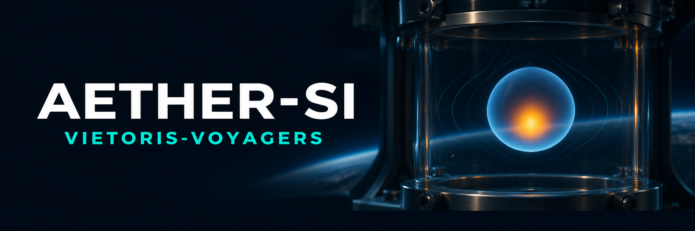
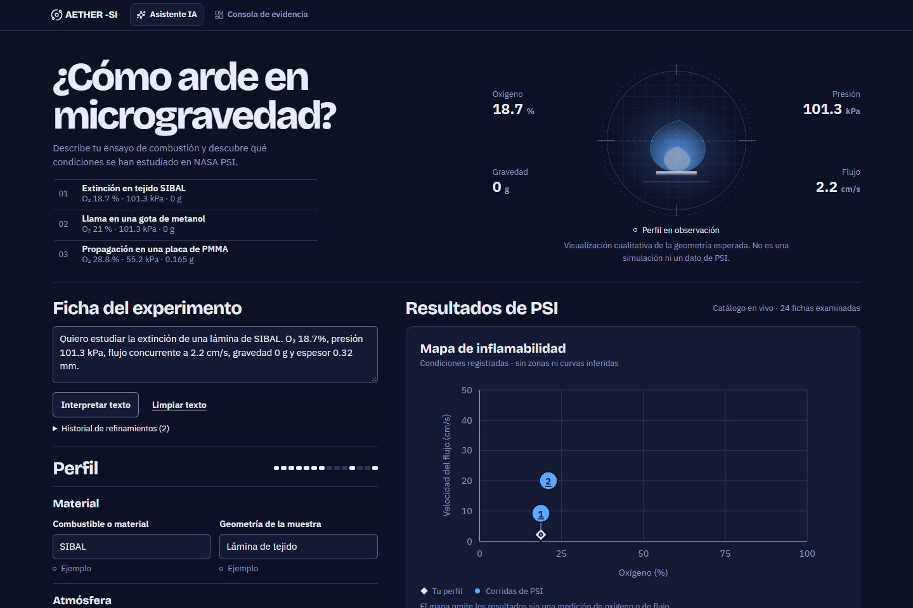
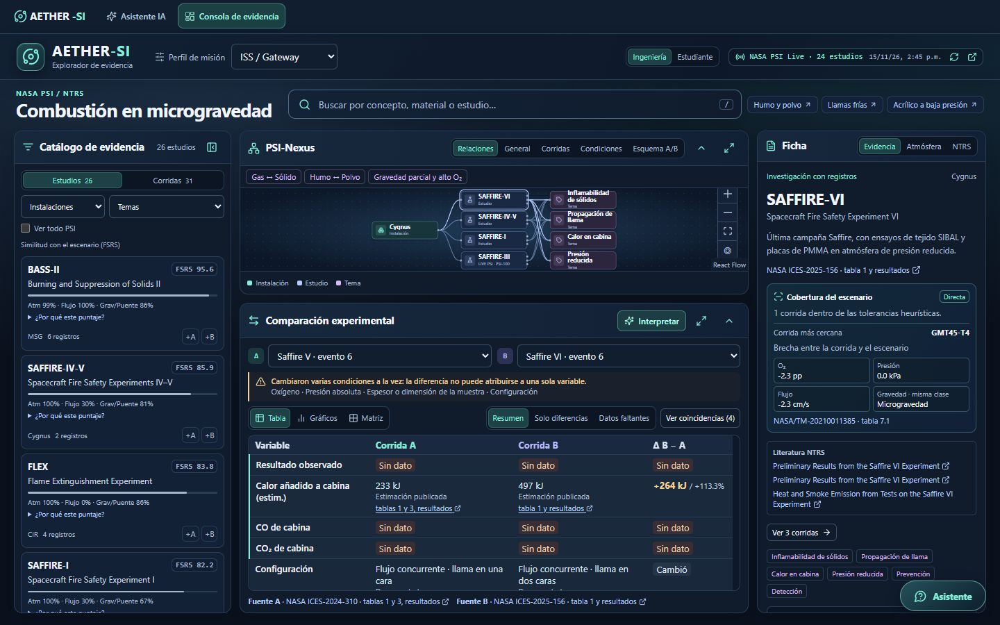

# AETHER-SI

**Explore microgravity combustion experiments and trace each comparison back to its source.**

Built by **Vietoris Voyagers** for the NASA Space Apps challenge *Flame in Freefall*.

[Open the demo](https://vietoris-voyagers-delta.vercel.app/) · [Try a guided example](#try-it-in-two-minutes) · [Run locally](#run-locally) · [Read the methods](#methods-and-data)



AETHER-SI helps researchers and students find experiments relevant to a proposed test, compare what was measured, and identify gaps in the available evidence. The app combines investigation records from **NASA Physical Sciences Informatics (PSI)** with technical literature from **NASA Technical Reports Server (NTRS)**. [Browse NASA PSI](https://psi.nasa.gov/physci/repo/search) · [Browse NASA NTRS](https://ntrs.nasa.gov/)

## Try it in two minutes

1. Start on **Asistente IA** and load the **Extinción en tejido SIBAL** example. You can also write a description or fill in the experiment profile directly.
2. Review the material, oxygen concentration, absolute pressure, gravity, and flow. Choose **Buscar ensayos comparables** to find related investigations.
3. Open the top match and inspect the conditions that drove its ranking. Follow the PSI accession to the investigation and the run citation to the documented observation.
4. Open **Consola de evidencia** to compare specific runs. Try searching for `BASS-II`, `llamas frías`, or `smoke detection`.

## Experiment Assistant



*The observation chamber illustrates the input profile. The chart plots the proposed conditions alongside documented experimental points.*

The assistant turns a written description into an editable profile and marks the values it extracted. Unspecified fields stay blank. After you confirm the profile, it ranks NASA PSI investigations by similarity of conditions and study topics. It returns five results by default, with a breakdown of matches, differences, and missing measurements.

The chart includes only recommendations with measured oxygen and flow values. When comparable runs support a qualitative hypothesis, the assistant shows its confidence, assumptions, limitations, and supporting records alongside it. When the evidence is insufficient, it says so.

## Evidence Console



| Tool | What you can do |
| --- | --- |
| **Evidence catalog and FSRS** | Search in English or Spanish and rank studies by similarity to a mission preset or a custom atmosphere. See how atmosphere, flow, and gravity contribute to the score. |
| **PSI-Nexus** | Trace relationships among facilities, topics, investigations, and runs. Use the mouse wheel to zoom and drag to pan. Open **Condiciones** to inspect experimental coverage. |
| **A/B comparison** | Select two runs with `+A` and `+B`, inspect conditions and outcomes with their sources, and filter to differences or missing values. The comparison flags when multiple conditions changed together. |
| **Evidence inspector** | Open the record and its sources, view coverage gaps, and explore schematic 3D or 2D scenes for supported runs. |
| **Console assistant** | Ask about a study, a run, or the current comparison. Answers can link to evidence and point to the relevant control or panel. Voice playback is optional. |

## Methods and data

| Topic | Reference |
| --- | --- |
| How FSRS measures scenario similarity and how rankings respond to changes in weights | [FSRS method](docs/fsrs.md) · [Stability analysis](docs/fsrs-stability.md) |
| How the app handles coverage, simultaneous changes, and interpretation | [Evidence and interpretation](docs/evidence.md) |
| PSI synchronization, cited measurements, and the versioned Combustion Science snapshot | [PSI integration](docs/psi-live.md) · [Data audit](docs/data-audit.md) |
| Evaluation questions and results | [Evaluation report](docs/eval.md) |

PSI provides investigations and experimental metadata. The NTRS radar presents technical literature separately. If NASA PSI is unavailable, the app uses a versioned snapshot for Combustion Science. Refresh that snapshot with `npm run snapshot:psi` when NASA PSI is reachable. [Snapshot and API details](docs/psi-live.md)

FSRS measures similarity to the selected scenario. Coverage describes how well available measurements support that scenario. AETHER-SI is intended for evidence exploration and research planning.

## Run locally

With **Node.js 24** and npm installed, run these commands from the repository root.

```sh
npm ci
npm run dev
```

[Open the local app](http://localhost:3000) or [go directly to the Evidence Console](http://localhost:3000/consola).

The app runs with its local evidence tools and basic text extraction without an API key. For optional AI or voice features, copy `.env.example` to `.env.local` and configure the server environment.

| Feature | Environment variables |
| --- | --- |
| **Gemini** | `AI_PROVIDER=gemini` and `GEMINI_API_KEY` |
| **Claude** | `AI_PROVIDER=anthropic` and `ANTHROPIC_API_KEY` |
| **Voice playback in the console** | `ELEVENLABS_API_KEY` and `ELEVENLABS_VOICE_ID` |

Use `AI_MODEL` to override the provider's default model. Keep API keys in the server environment. [Complete environment template](.env.example)

The project uses **Next.js, React, TypeScript, Zustand, React Flow, and Vitest**. Run the checks below before sharing changes.

```sh
npm run lint
npm run typecheck
npm test
npm run build
```

## License and attribution

The source code is licensed under **MIT**. NASA records and publications retain their original terms. Where available, investigation cards preserve the source license and link to the original record. AETHER-SI is an independent project by **Vietoris Voyagers**. [MIT license](LICENSE) · [Third-party licenses and data attribution](THIRD_PARTY.md)
