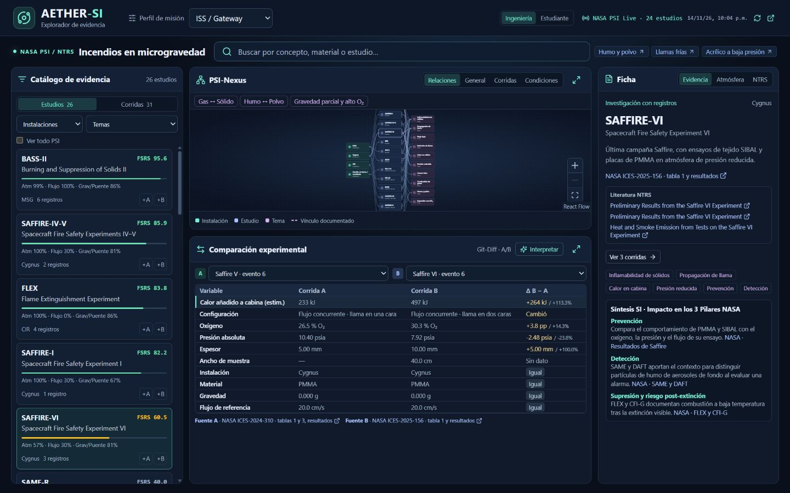
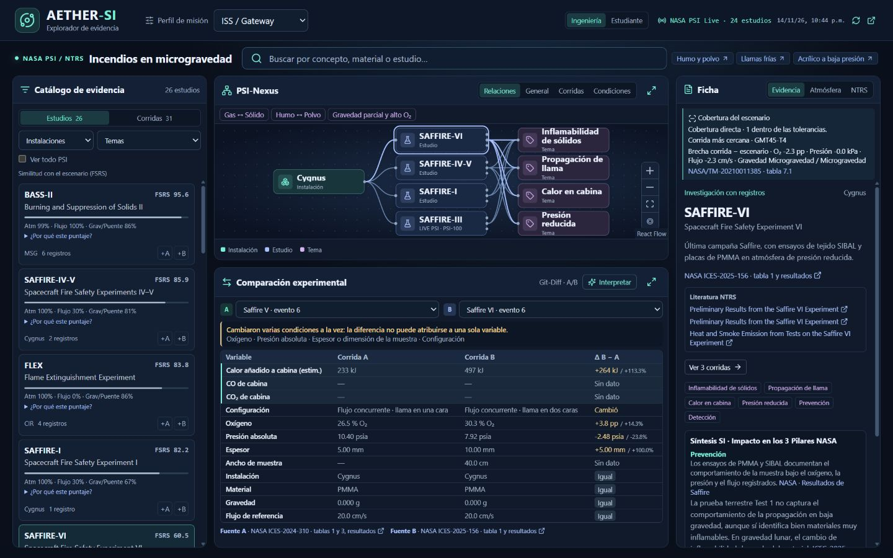

# Cobertura e interpretación

La cobertura usa corridas curadas. Excluye perfiles nominales, perfiles inferidos y cualquier eje marcado como nominal. Un eje faltante no cuenta dentro de la tolerancia.

Las tolerancias iniciales son heurísticas y ajustables en `src/data/coverage_config.ts`. Son ±3 pp de O₂, ±10 kPa de presión y ±5 cm/s de flujo, con coincidencia por clase de gravedad. La clase asigna el valor registrado al centro más cercano entre microgravedad, Luna, Marte y Tierra.

- **Directa** si una corrida satisface las cuatro tolerancias.
- **Parcial** si alguna corrida coincide en algún eje y el O₂ objetivo no queda fuera del intervalo observado ampliado por su tolerancia.
- **Ninguna** en los demás casos. La tarjeta conserva la corrida más cercana si existe y cita su fuente.

La distancia suma las brechas absolutas normalizadas por las tolerancias. Un eje faltante y una clase de gravedad distinta aportan dos unidades heurísticas. Los empates se resuelven por identificador. La cobertura describe el catálogo disponible y no estima resultados fuera de él.

La ruta de interpretación reconstruye registros, resultados y diferencias desde el catálogo del servidor. El paquete enviado al modelo contiene cifras con unidades, fuentes, cobertura y cambios simultáneos. La validación comprueba citas, unidades y signos, y permite redondear al último decimal mostrado (media unidad de ese decimal). También filtra expresiones de causalidad literal en comparaciones confundidas y frases de certificación o seguridad. Este filtro textual no verifica por sí solo el significado de toda afirmación.

Con cobertura ninguna, la app se abstiene y enlaza la corrida más cercana. Si el proveedor no está configurado, se agota el tiempo o no se obtiene una salida válida, se muestra la plantilla determinista. La ruta limita el cuerpo a 20 KB y la generación a 10 segundos, con un solo reintento. El límite de 20 solicitudes de generación por minuto es compartido por instancia y se reinicia al cambiar de instancia en serverless.

## PSI-Nexus a 1440 × 900

En Relaciones, la selección inicial muestra el estudio activo con hasta tres estudios afines y cuatro temas. General permite explorar el conjunto completo. El botón de centrado enfoca el nodo seleccionado y los controles de zoom, ampliación y teclado siguen disponibles.

| Antes | Después |
| --- | --- |
|  |  |

## Escena del experimento

Abre **Escena del experimento** desde una corrida con un montaje compatible. Las dimensiones del dibujo son esquemáticas. La ficha muestra los valores registrados con su unidad y su fuente.

- **Muestras sólidas (BASS-II y Saffire).** Una lámina dentro de un conducto esquemático. La ficha presenta el espesor y el ancho publicados cuando existen. Las flechas indican el flujo concurrente medido. La forma de la llama se basa en la descripción de la corrida.
- **Gotas aisladas (FLEX).** Una gota en el montaje MDCA. La ficha distingue el diámetro inicial del diámetro de la gota al extinguirse la llama visible, cuando se reporta. La velocidad del aire de estas corridas es un valor nominal y queda fuera de la escena. [Informe NASA/TP–2015-216046, tabla IX](https://ntrs.nasa.gov/citations/20150023456)
- **Aerosoles (SAME y SAME-R).** Un montaje de pirólisis sin llama con partículas simbólicas. La ficha muestra el flujo medido, el tiempo de envejecimiento del aerosol y, cuando se reporta, el tiempo de calentamiento. El flujo medido de 0 cm/s se distingue de una velocidad sin dato. [SAME en NASA PSI](https://psi.nasa.gov/physci/repo/data/investigations/PSI-102) · [SAME-R en NASA PSI](https://psi.nasa.gov/physci/repo/data/investigations/PSI-101)

Las fichas generales y los perfiles nominales o inferidos se consultan como contexto del estudio. Los experimentos con gases del catálogo curado se presentan actualmente como perfiles de referencia.

> Representación ilustrativa de las condiciones del experimento; no es una predicción.

La escena 3D se carga al abrirla en una pantalla amplia. El diagrama 2D queda disponible en el mismo panel y se usa en pantallas estrechas o si falla WebGL. `NEXT_PUBLIC_EXPERIMENT_SCENE=false` oculta el control tras volver a compilar. [Informe de evaluación](eval.md)
